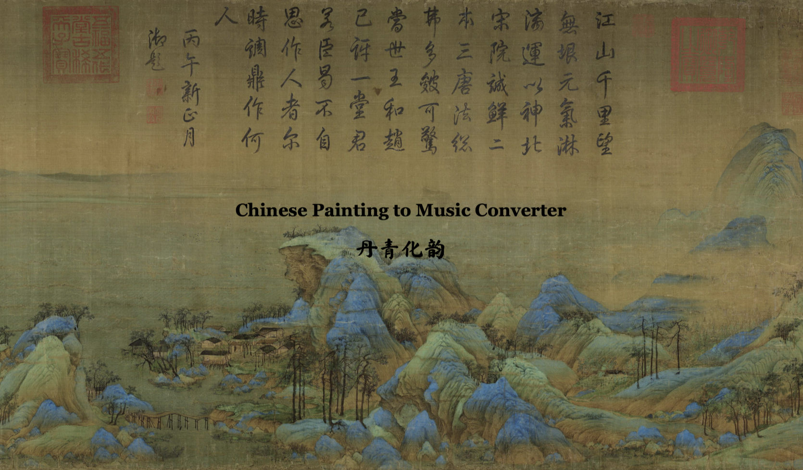
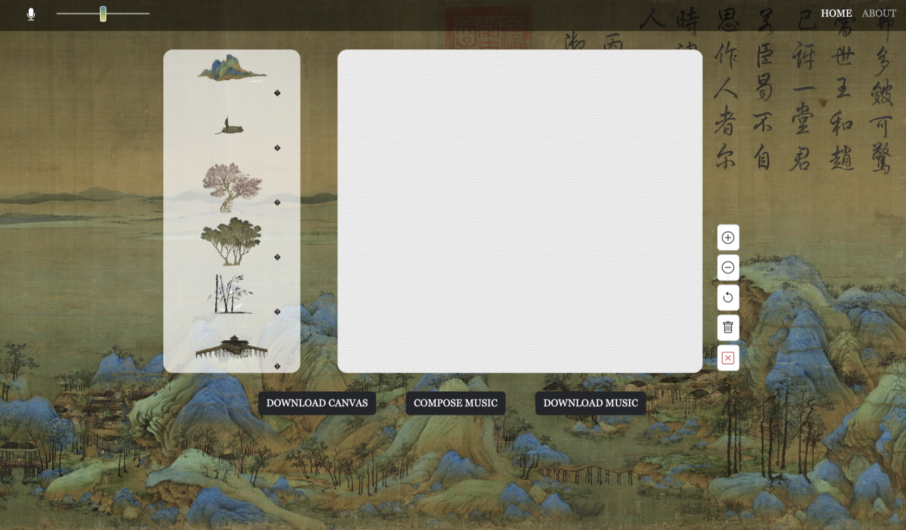
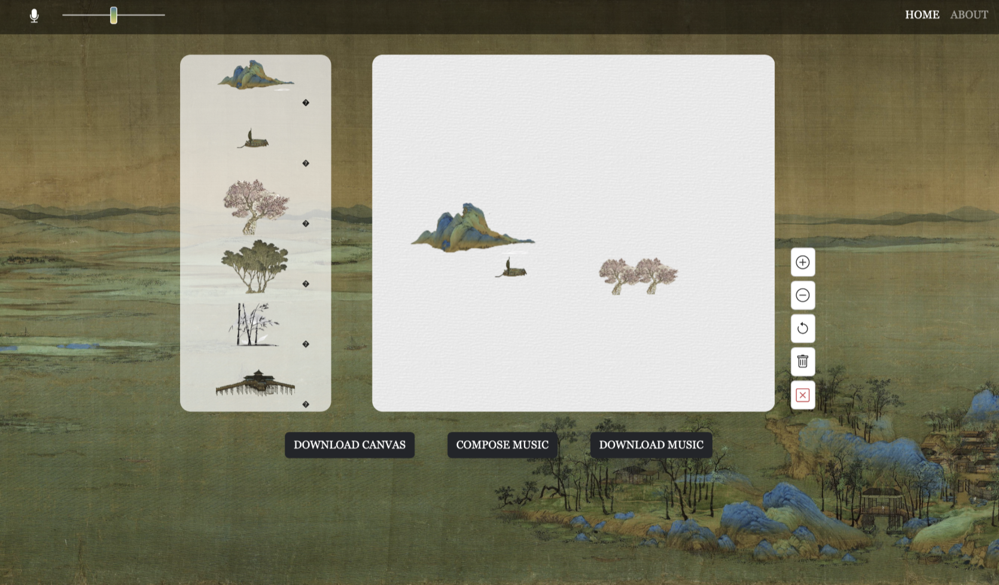
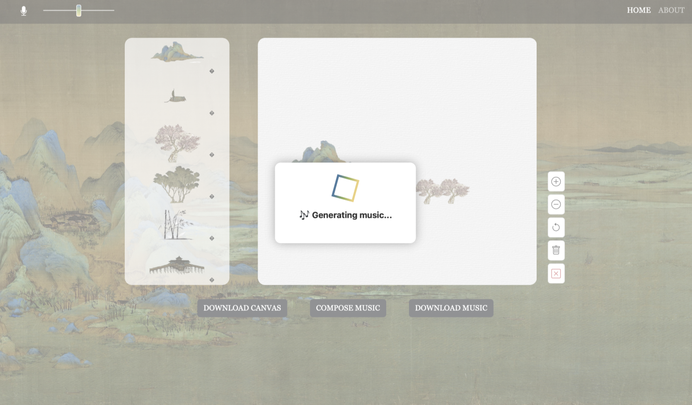
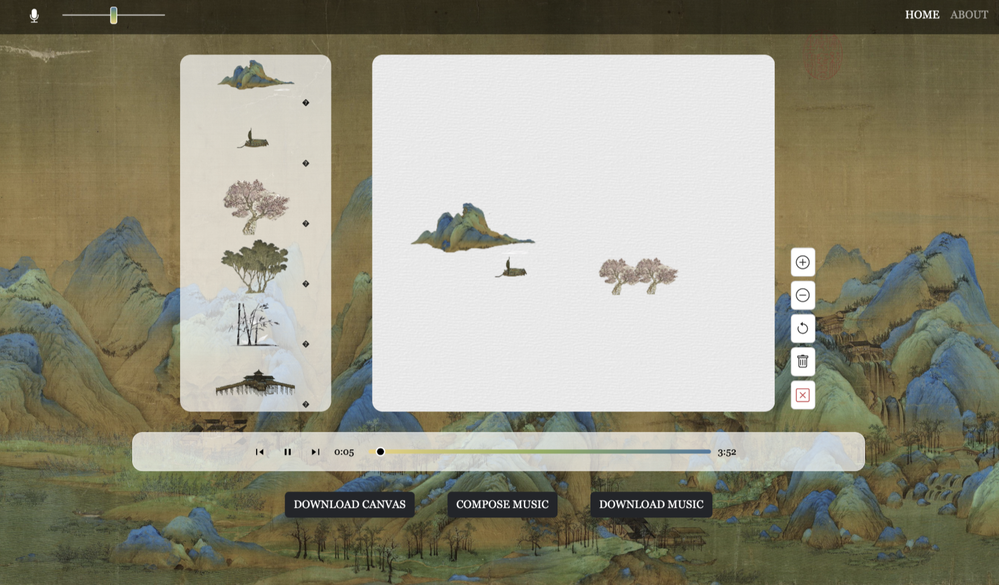
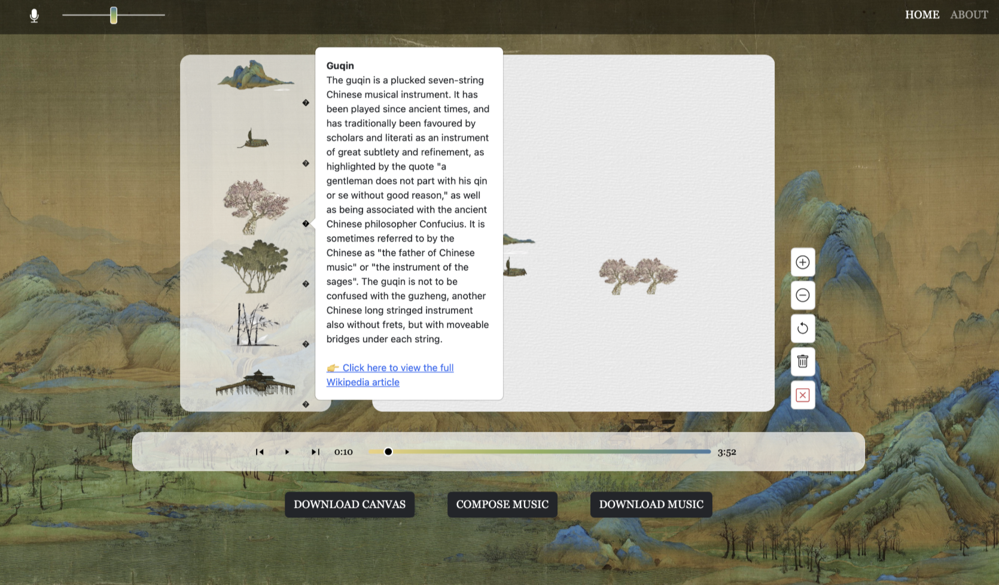

# 丹青化韵

面向海外用户的 AI 文化互动网页。用户可自由组合山峰、树木、小船等图案创作中国山水画，并生成对应的个性化民乐，在绘画与音乐互动中体验中国传统文化。

> **仅限非商业使用。** 允许学习、研究和个人实验，禁止未经授权的商业用途，详见 [LICENSE](LICENSE)。

## 界面展示

### 1. 首页



### 2. 创作界面



### 3. 山水画创作示例



### 4. 音乐生成中



### 5. 音乐播放



### 6. 传统乐器文化介绍



## 功能

- **绘画创作**：拖拽图案，自由调整布局，支持撤销和清空。
- **AI 配乐**：根据绘画图案搭配传统乐器，通过 Mureka 生成音乐，支持播放和下载。
- **文化探索**：试听传统乐器，查看相关文化介绍。

## 本地运行

需要 Python 3.10+、联网环境，以及用于音乐生成的 Mureka API Key。无需安装额外 Python 依赖。

### 1. 下载项目

```bash
git clone https://github.com/zhaoshutiao/danqing-music.git
cd danqing-music
```

也可以通过 **Code → Download ZIP** 下载并解压。

### 2. 配置密钥

将 `.env.example` 复制为 `.env`：

```bash
# macOS / Linux
cp .env.example .env
```

```powershell
# Windows PowerShell
Copy-Item .env.example .env
```

用文本编辑器打开 `.env`，填入自己的密钥并保存：

```dotenv
MUREKA_API_KEY=你的密钥
```

密钥仅由本地后端读取，不发送到浏览器。`.env` 已被 Git 忽略，请勿将真实密钥写入代码或提交到仓库。

### 3. 启动服务

```bash
# macOS / Linux
python3 server.py
```

```powershell
# Windows PowerShell
py -3 server.py
```

打开 [http://127.0.0.1:8000](http://127.0.0.1:8000)，不要直接双击 HTML。按 Ctrl+C 停止服务；修改密钥后需重启。

未配置密钥时仍可体验绘画和乐器试听，无法生成音乐。

## 实现方式

前端使用 HTML、CSS 和 JavaScript，本地 Python 服务负责提供页面并代理 Mureka 请求。绘画图案通过固定规则对应传统乐器，再组合成音乐提示词。

| 图案 | 乐器 |
|---|---|
| 山峰 | 编钟 |
| 小船 | 笛子 |
| 花树 | 古琴 |
| 松树 | 琵琶 |
| 竹子 | 笙 |
| 水中亭 | 古筝 |

## 使用说明

- 音乐生成消耗使用者自己的 Mureka 额度；生成结果可能不完全遵循提示词。
- 生成超时后，远程任务可能仍在运行，请避免连续重复提交。
- 若下载按钮打开音频链接，可使用浏览器的保存功能。
- 页面部分依赖 CDN、在线字体和 Wikipedia，需要联网。
- 当前版本用于本地运行，GitHub Pages 无法运行 Python 后端。
- 整理版尚未使用有效密钥完成真实生成验证，检查范围见 [VERIFICATION.md](VERIFICATION.md)。

## 作者与素材

zhao · zhang

图片和音频的来源及再分发许可待核实，详见 [ASSETS.md](ASSETS.md)。原创代码与文档采用[自定义非商业许可](LICENSE)，不采用 MIT 许可；第三方素材不在该授权范围内。
